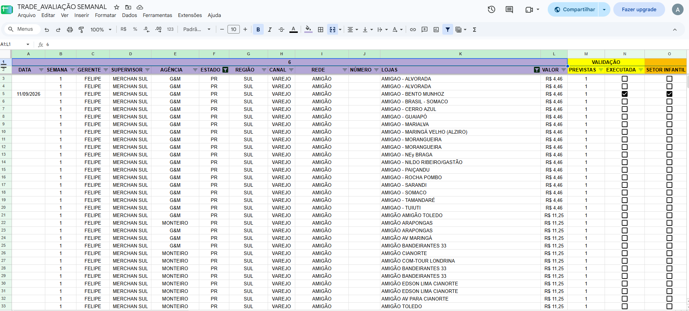
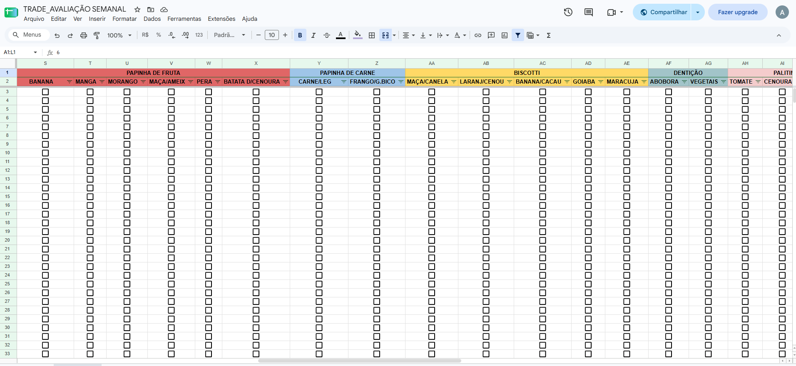
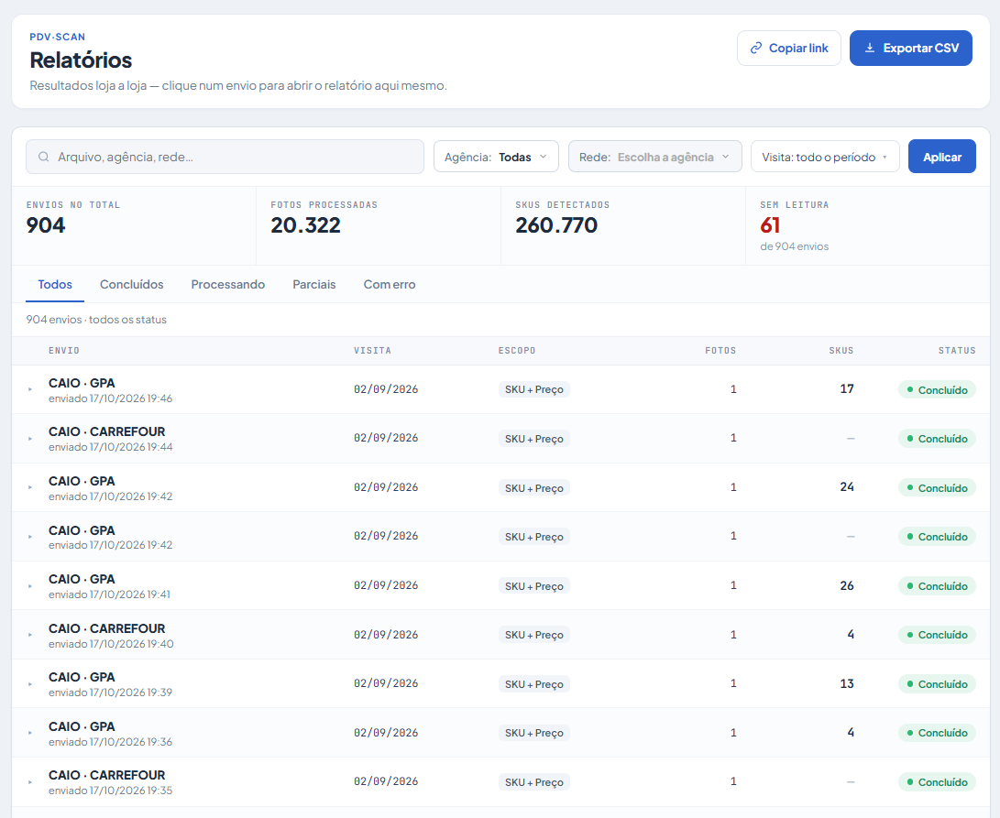
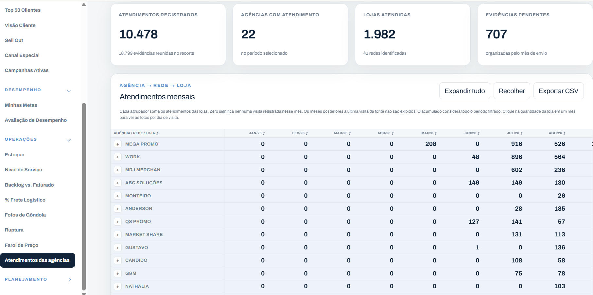
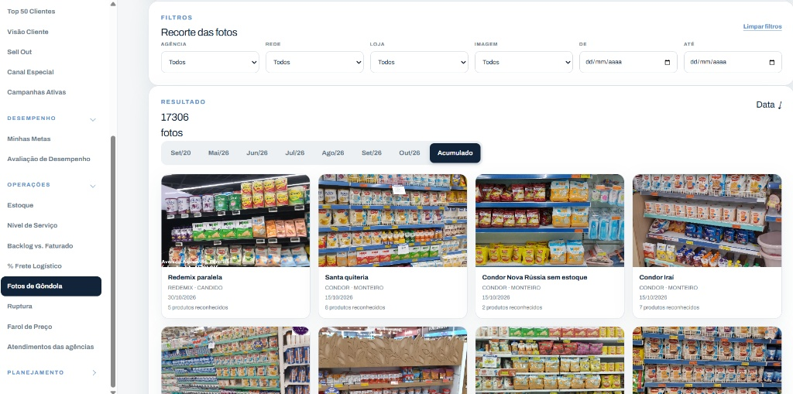
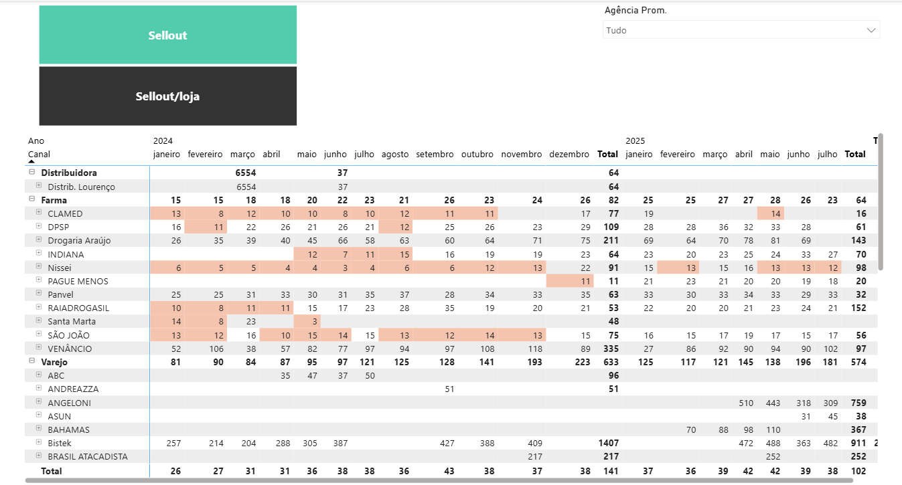
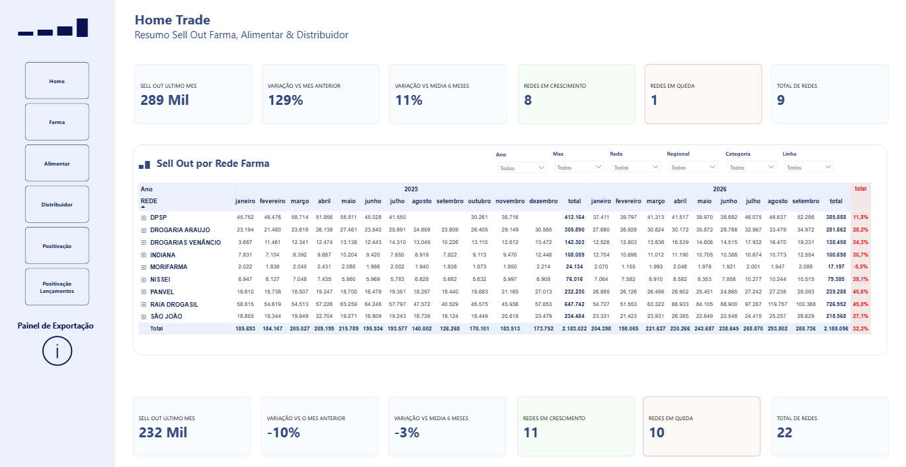
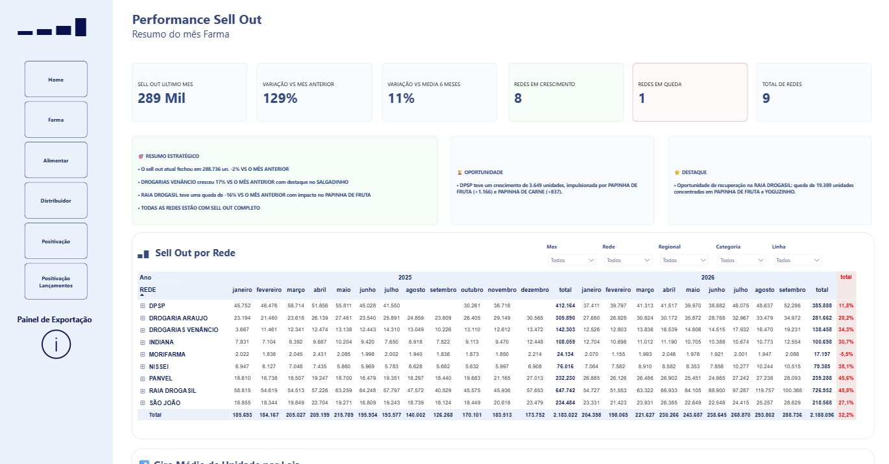
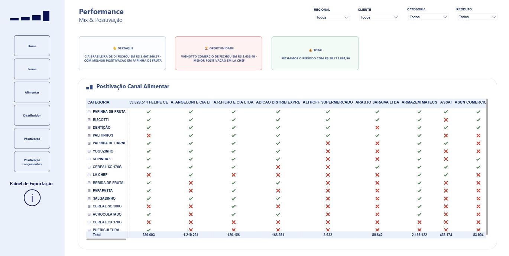

# 👩🏻‍💻 Amanda Petersen

**`Analista de Dados & Business Intelligence`**

Me chamo Amanda Petersen, sou de Curitiba-PR e atuo focada em transformar complexidade em eficiência por meio de automação, engenharia analítica e inteligência artificial. Sou especialista na integração de bancos de dados, construção de pipelines e desenvolvimento de dashboards escaláveis que sustentam decisões estratégicas de negócio.

Possuo experiência na condução de projetos de robotização, automação de processos de Trade Marketing e desenvolvimento de soluções analíticas end-to-end.

    
    
    

---

### 🤖 Dados, BI & Tecnologias

  
  
  
  
  
  
  
  
  
  
  
  

---

### 💼 Cases de Sucesso & Experiência em Destaque

  
<b>🚀 Projeto PDV Scan: Robotização e Automação de Trade Marketing</b>

   

  > **O Desafio & A Solução:** Redesenho completo de um fluxo de auditoria de Ponto de Venda. Transição de um processo puramente manual e engessado para um ecossistema automatizado ponta a ponta via API, Visão Computacional e engenharia de dados.

  ---

  ### 🔴 O Cenário Anterior (Processo Manual)
  * O fluxo dependia de planilhas operacionais extensas e preenchimento manual exaustivo (foto por foto) por parte da equipe para validação de rupturas e execução.
  
  

    
  

  

    
  

  ---

  ### 🟢 A Solução Automatizada (O "Depois")
  * **Arquitetura & API:** Criação de rotinas inteligentes para recebimento, tratamento e processamento em massa das imagens de campo.
  * **Métricas Extraídas Automaticamente:** Rupturas, *share* de gôndola, leitura de preços, posicionamento e blocagem.

  **1. Central de Relatórios e Status de Processamento da API:**
  

    
  

  **2. Visão Executiva e Indicadores de Atendimentos:**
  

    
  

  **3. Módulo de Galeria e Auditoria de Fotos de Gôndola:**
  

    
  

  * **O Impacto:** Eliminação total do retrabalho operacional manual, alta escalabilidade no volume de auditorias processadas e entrega ágil de *insights* estratégicos para a tomada de decisão da diretoria comercial.

---

  
<b>🎨 Evoluição Visual e UX: Redesign do Painel de BI (Antes vs. Depois)</b>

   

  > **O Impacto do Redesign:** Transição de uma tabela estática e monótona para um ecossistema analítico completo, com menus de navegação fluidos, *cards* automatizados com *insights* de negócio, matrizes de positivação e hierarquia visual executiva.

  ### 🔴 O Cenário Anterior (O "Antes")
  * Tabela estática sem KPIs executivos, filtros dispersos e alta dificuldade de leitura rápida.
  
  

  ---

  ### 🟢 A Solução Desenvolvida (O "Depois")

  **Tela 1: Home Trade & Resumo Geral**
  

  **Tela 2: Performance com Insights Estratégicos & Oportunidades**
  

  **Tela 3: Matriz de Positivação (Canal Alimentar)**
  

---

### ⚡ Competências & Foco de Atuação

| Categoria | Tecnologias & Soluções |
| :--- | :--- |
| **📊 Business Intelligence & Analytics** | Power BI (DAX, Power Query), Modelagem Dimensional, Dashboards Executivos |
| **🐍 Engenharia de Dados & ETL** | Python, SQL Avançado, PostgreSQL, Tratamento & Saneamento de Dados |
| **🤖 Automação & Inteligência Artificial** | Robotização de Processos (RPA), Engenharia de Prompts (ChatGPT, Gemini, Claude) |
| **💻 Desenvolvimento & Ferramentas** | Git/GitHub, HTML5, CSS3, JavaScript, Java, Spring Boot, Linux |

> 🚀 *Foco contínuo em transformar dados brutos em inteligência acionável e alta eficiência operacional.*
